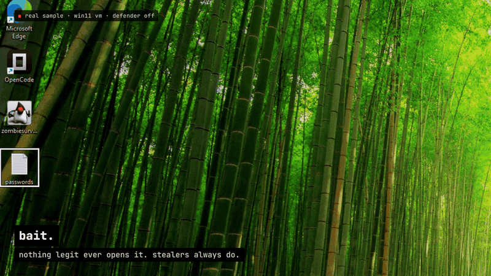
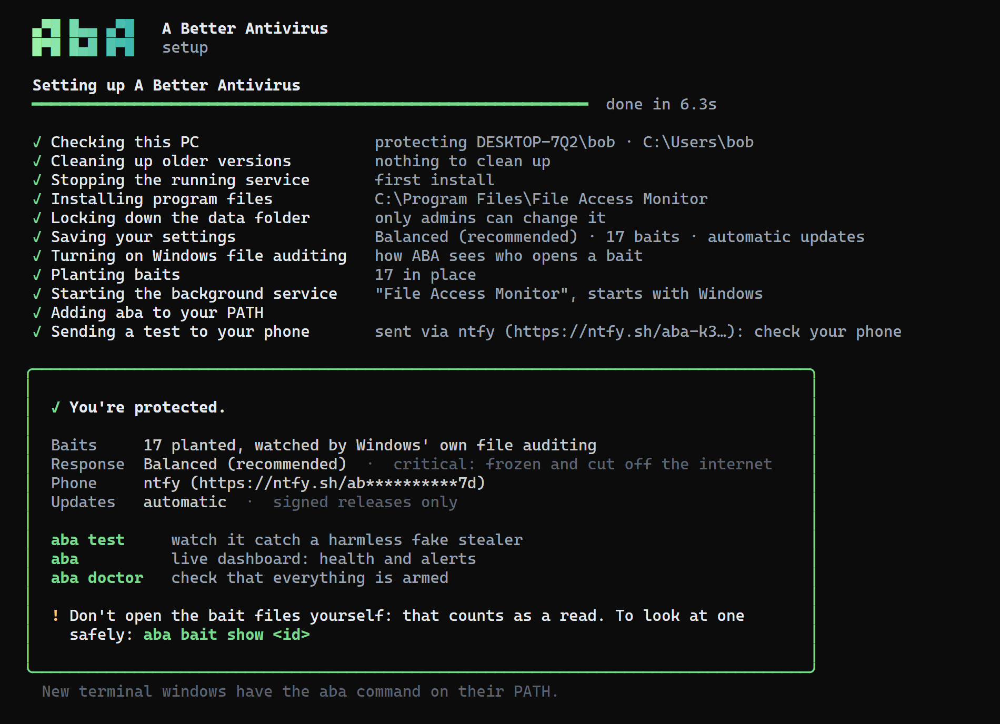

<div align="center">

# A Better Antivirus

**It's not an antivirus. It's a better one.**

Catch infostealers in the act. ABA plants fake passwords, wallets and app data<br>
that honest software has no reason to read, and freezes whatever goes for them.

**[abetterantivirus.com](https://abetterantivirus.com)**

[](https://github.com/vulnix0x4/a-better-antivirus/releases/latest)
[](https://github.com/vulnix0x4/a-better-antivirus/actions/workflows/ci.yml)
[](https://github.com/vulnix0x4/a-better-antivirus/releases)
[](#install)
[](LICENSE)
[](https://gitgem.org/github/vulnix0x4/a-better-antivirus)

<a href="docs/demo.mp4"></a>

<sub>A real Discord token stealer with Windows Defender off. It went for a fake Discord token and was frozen 158 ms later.<br><a href="docs/demo.mp4">Watch the full video with sound (47 s)</a></sub>

</div>

Despite the name, **keep Windows Defender on.** Antivirus tries to stop malware from running; ABA is the tripwire for when something gets past it, and that's the part antivirus is bad at.

## Install

On a Mac or Linux? See [Linux and macOS](#linux-and-macos-early).

### Installer (Windows 10/11, 64-bit)

Download **[ABA-Setup.exe](https://github.com/vulnix0x4/a-better-antivirus/releases/latest/download/ABA-Setup.exe)** and double-click it. It carries both the x64 and Arm64 builds of `aba.exe`, asks a few questions (phone alerts, whether to catch clippers and hidden crypto miners, automatic updates), sets up the recommended baits with Balanced protection, and offers a **safe test** at the end. Running it again on an existing install updates or repairs ABA without changing your settings.

> Releases aren't code-signed yet, so Windows SmartScreen may warn you. Check the file's SHA-256 against `SHA256SUMS.txt` on [Releases](https://github.com/vulnix0x4/a-better-antivirus/releases/latest) first:
> ```powershell
> (Get-FileHash .\ABA-Setup.exe -Algorithm SHA256).Hash
> ```
> If it matches, click **More info → Run anyway**.

### PowerShell

Prefer the terminal (or want to pick every bait and response yourself)? In PowerShell:

```powershell
irm https://raw.githubusercontent.com/vulnix0x4/a-better-antivirus/main/install.ps1 | iex
```

It downloads the latest release for your PC, checks that its checksum list carries a valid signature from ABA's release key, checks the download against it, and starts the guided setup ([read the script first](install.ps1) if you like). Setup takes about a minute:

- **Recommended** asks just a few things (phone alerts, whether to detect [clippers](#clipboard-bait-windows) and [hidden crypto miners](#miner-trap-windows), automatic updates) and uses sensible defaults for the rest. **Customize** lets you pick every bait and response.
- If you set up phone alerts, it sends a test notification so you know they work.
- It ends by offering a **safe test**: a harmless fake stealer reads a bait and you watch ABA freeze it.
- Afterwards `aba` works in the same PowerShell window.

<p align="center"></p>

<details>
<summary><b>Other ways to install (silent flags, test VMs, by hand)</b></summary>

**Silent installer** (same defaults as clicking Next all the way — recommended baits, Balanced response, no phone alerts, automatic updates on — except that the clipper and miner traps stay off unless you ask for them):

```powershell
.\ABA-Setup.exe /VERYSILENT /SUPPRESSMSGBOXES /NORESTART
```

Optional flags (first install only; an existing install keeps its settings):

| Flag | Meaning |
|---|---|
| `/NTFYTOPIC=my-topic` | Send phone alerts to this [ntfy](https://ntfy.sh) topic (letters, digits, `-`, `_`) |
| `/AUTOUPDATE=0` | Don't update automatically (`1`, the default, does) |
| `/CLIPPERS=1` | Detect clippers with the clipboard bait (`0` or not given: off) |
| `/MINERS=1` | Detect hidden crypto miners with the miner trap (`0` or not given: off) |
| `/PRESET=alert\|balanced\|strict` | Response preset (default `balanced`) |
| `/LEARNING=3` | Days of learning mode; only changes something with `strict` (default `0`) |
| `/CANARYEMAIL=me@example.com` | Create canary tokens that email this address |
| `/BAITS=id,id` | Plant specific baits instead of the recommended set (`aba bait catalog` lists them) |
| `/LOG=setup.log` | Write Inno Setup's log, including ABA's output (keep it private: it records your command line and user folder) |

**Test VM, no questions asked** (strict mode, no learning period):

```powershell
$env:ABA_ARGS = 'install --yes --preset strict --learning 0'; irm https://raw.githubusercontent.com/vulnix0x4/a-better-antivirus/main/install.ps1 | iex
```

**By hand:** download `aba_<version>_windows_amd64.exe` (or `arm64`) from [Releases](https://github.com/vulnix0x4/a-better-antivirus/releases/latest), verify its SHA-256 against `SHA256SUMS.txt`, and run it with `install`.

> Only ever paste `irm … | iex` commands from sources you trust: it's also how many infostealers get installed ("paste this to fix your PC"). This script is open, and refuses to run a download that isn't in a checksum list signed with ABA's release key.

</details>

## Why this works

Infostealers (Lumma, RedLine, Vidar, StealC…) are the most common malware on personal PCs. They sweep your browsers, wallets, Discord and Telegram sessions, and documents, zip it all up and upload it — usually within seconds. Most **collect first and upload at the end**, and collecting means opening files in known places. ABA puts tripwires in those exact places.

- **Fake files** where file grabbers look: a password list on the Desktop, in Documents and in your home folder, a wallet recovery phrase, 2FA backup codes, and a KeePass database. Every install names them differently (from what grabbers search for), so they can't be skipped by name.
- **Fake app data for apps you don't use:** Opera, Vivaldi, Yandex and Brave browser profiles (real SQLite databases with saved logins and cookies), MetaMask, Exodus, Electrum and Atomic wallets, Telegram sessions, Discord tokens, FileZilla servers, and AWS keys. Nothing legitimate reads these when the app isn't installed, so the signal is clean. ABA checks what you actually have installed and never fakes data for those apps. If you install one later, ABA notices, retires that decoy and tells you — it has to be the real thing, signed by its publisher in its install folder; a file that merely looks like the real app is reported instead.
- **A fake profile inside the browsers you do use:** a `Profile 23` (or similar) folder next to your real profiles in Chrome, Edge and Brave, with saved logins and cookies. Stealers take every profile folder; the browser itself only opens the ones it knows, so it never touches this one. Checking whether the browser is installed doesn't help a stealer dodge it. Nor does running its code inside the genuine browser to get past the browser's own cookie encryption: on Windows, a browser that opens the fake profile and was started suspended, hidden, with no window on your screen, or by a program ABA wouldn't trust, is a stealer's throwaway copy, and it's frozen whole along with whatever started it. If it's the browser window you're actually using, ABA doesn't freeze it (you'd lose your work): it cuts the internet of every window of that browser and tells you, and one click gives it back.
- **Canary tokens** (optional): the fake AWS keys and a link in `passwords.txt` are real [canarytokens.org](https://canarytokens.org) tokens. If an infostealer gets your data and someone *uses* them later, you get an email — even if your PC was never online to tell you.

ABA catches infostealers by **what they do**, not by recognising the file, so it works on brand-new ones no antivirus has a signature for yet.

```
> aba test

 A harmless copy of ABA in your Temp folder is about to read passwords.txt on the Desktop,
 exactly the way a stealer would. Nothing leaves your PC and your network isn't touched.

 ✓ Caught      critical: unsigned program running from a user-writable folder: typical of stealers
 ✓ Frozen      72 ms after it opened the bait, before it could read a byte
 ✓ Alerted     popup on your desktop, and your phone (ntfy)
 ✓ Cleaned up  the fake stealer was killed and deleted
```

## How it works

```
 stealer opens a bait
        │
        ├──► instant freeze: oplock breaks immediately (~0.1 s to freeze) ──┐
        │                                                                    ▼
        └──► backup: NTFS audit rule ──► Security event 4663 ──► ABA service (SYSTEM)
             (Windows delivers these in a few ms to ~1 s)                    │
               1. instant verdict from path/name ───┤ unsigned + Temp/AppData/Downloads? script host?
               2. freeze the process tree ──────────┤ (already frozen on the instant path)
               3. verify the code signature ────────┤ signed legit app? → unfreeze, just note it
               4. collect forensics while frozen ───┤ command line, parents, hash, connections
               5. block / kill / isolate ───────────┤ as configured
               6. alert ────────────────────────────┤ desktop popup + toast + phone
               7. autopsy, still frozen ────────────┘ did it already take your real data?
```

- **Instant freeze** (on by default, `aba instant on|off`): ABA holds an exclusive *opportunistic lock* on every bait so Windows tells it the moment one is opened. If the opener is suspicious, ABA freezes it right away — typically ~0.1 s after the open (72–151 ms in CI) — instead of waiting for the event log. To stay safe, it only acts on ordinary non-admin programs running as you (never system processes or ABA itself), and if it can't pinpoint the opener with certainty it doesn't guess.
- **Event-log backup** uses Windows' own file auditing (an NTFS audit rule on each bait, read through the Security event log). No kernel driver, no background scanning, no CPU use while idle. Malware running as you can neither see nor remove the audit rules, and can't read ABA's files to find out where the baits are.

<details>
<summary><b>Under the hood: oplocks, non-blocking opens, execute-only mappings and hard links</b></summary>

- **Finding the opener from an oplock:** When a program opens a guarded bait, Windows pauses it inside its open call and notifies ABA, without naming the PID. ABA snapshots the threads that entered a kernel wait at that moment and are still stuck a few milliseconds later, then releases the oplock. The opener wakes at that exact instant; an innocent thread waiting on something else (like a pipe) stays stuck. Identified precisely, never guessed — if more than one program wakes at once, ABA leaves it to the event log. (If a program already known to be sweeping is among the paused threads, ABA decides while its open is still held.)
- **Non-blocking ("ghost") opens:** A program can ask Windows *not* to pause it (`FILE_COMPLETE_IF_OPLOCKED`), so no thread is ever stuck. That open still leaves a handle behind, which ABA queries (`NtQueryInformationFile`) to find who newly holds the bait before it can read through the handle. Refusing to be paused is itself flagged as evasion (**critical**).
- **Execute-only mappings:** A program can open a bait for execute access only (`FILE_EXECUTE`) and map it into memory to read its bytes without ever asking for read access. Both ABA's oplock guard and its NTFS audit rule treat execute access on a bait as a read, so it's caught on both paths (and paired with a non-blocking open, it's also flagged as evasion).
- **Hard links:** Anything running as you can create a hard link to a bait and open it under a path ABA has never seen. The oplock and audit rule belong to the underlying file, so ABA matches audited opens by NTFS file ID — and if the link was deleted before the event arrived, correlates it with the oplock open it just saw. Reading a bait through a hard link is flagged as evasion (**critical**).

</details>

- **Severity** is automatic. Malware without admin rights can't write to `Program Files` or `Windows`, and infostealers are almost always unsigned binaries in user-writable folders or abuse script hosts like PowerShell or mshta:

  | Reader | Severity |
  |---|---|
  | Anything that goes through **several apps' data** within 2 minutes (a sweep), alone or split over several programs | **critical** |
  | Anything using a **trick to read unseen**: opening a bait so Windows doesn't pause it, a hard link, a copy of ABA as a disguise | **critical** |
  | A Windows program running **injected code** (code that isn't from any file on disk) | **critical** |
  | Unsigned program in Temp, AppData, Downloads, Desktop… or inside the Windows folder | **critical** |
  | Signed program in a user folder running an **unsigned DLL from its own folder** (sideloading) | **critical** |
  | PowerShell, cmd, mshta, rundll32, wscript, Windows tools that copy or upload a file for you (certutil, extrac32, certreq, scp…), and tools stealers hide in (RegAsm, AppLaunch, vbc, MSBuild, more.com…) | **critical** |
  | Java, Python, Node… running a script or `.jar` from your Desktop, Downloads or Temp (a "game" you double-clicked) | **critical** |
  | The genuine browser opening the **fake profile inside it** (Windows): code is running inside it. Started suspended, hidden, with no window, or by an untrusted program: frozen whole, with what started it. The browser you're using: left running, its internet cut | **critical** |
  | Signed app in a user folder, scripting runtimes (Python, Node, Java), other Windows programs in your session, network share reads | **warn** |
  | Signed, installed software (Program Files), Windows services, the preview pane | **info**: noted quietly, no popup |
  | Defender, Windows Search, your trust rules | ignored |

- **Behaviour beats identity.** Infostealers often hide inside a legitimate program (process injection / hollowing), so *who* opened a bait can lie. *What* it opened can't: a real app only touches its own data, while a stealer grabs everything it knows in seconds. A process that reads several different apps' baits (your password files count as one; browsers, Discord, wallets… each count on their own) is stopped as a stealer whatever it claims to be — signed, trusted by you, or part of Windows. Only Defender, Windows Search and programs you explicitly allow to read everything (such as a backup tool) are exempt. When a Windows program reads a bait, ABA also looks inside it for a whole program running from memory that isn't backed by any file, the footprint of injected code.

- **Destroying a bait counts like reading one.** A program that opens a bait only to write to it, or deletes it, has no use for what's in it: that's what ransomware and wipers do to a file. So one that would be stopped for reading a bait (an unsigned program in a user-writable folder, a script host) is stopped the same way for going to overwrite or delete it, inside the open where the system can hold it there. And a program that goes to overwrite your *documents* in two different folders within two minutes is stopped as ransomware whatever it is or is signed by, except the system's own sync (OneDrive and iCloud put your Desktop and Documents back file by file). A program that looks legitimate deleting one bait (you in Explorer, a cleaner) is only reported, and the bait put back; so is a script host deleting one (you at a prompt, or a script of yours), but a script that deletes your documents in two folders is stopped as a wiper.
- **Responses** per severity:

  | Preset | Critical | Warn |
  |---|---|---|
  | Alert only | notify | notify |
  | **Balanced** (default) | freeze + block that program's internet | notify |
  | Strict | freeze + block + isolate the PC | freeze |

  Isolation uses the Windows Filtering Platform (the same engine enterprise "isolate device" uses). It survives reboots so malware can't wait it out, and still lets ABA's own phone alerts through. `aba release` undoes everything.

- **Frozen means frozen.** A stealer is rarely one process, and anything running as you can un-suspend a suspended process. ABA freezes the whole thing — the reader and what it started, the unsigned loader or script host that started *it*, and other running copies of the same file — and holds them in a frozen job object that only the ABA service can reach, so no accomplice can thaw them (`aba resume` and `aba release` ask the service to). Windows' own processes are never frozen, checked by the real file on disk: a stealer that calls itself `svchost.exe` is.

## Everyday use

```
aba              live dashboard
aba test         simulate a stealer safely and watch it get caught
aba alerts       what touched your baits (aba alerts show <id> for everything)
aba doctor       check everything is armed (--fix to repair)
aba learn        trust several of your own apps at once
```

When something trips:

```
aba trust <id>       it's yours: undo everything and stop alerting about it
aba kill <id>        it's malware: end what the alert froze (it stays cut off; the evidence is kept)
aba resume <id>      not sure: let it run again, without trusting it
aba release          undo all responses: network back, everything unfrozen/unblocked
aba autopsy <id>     did it take your real data? everything ABA found while it was frozen
aba export-ioc <id>  write a file of what's safe to share about it (nothing is uploaded)
```

Setup:

```
aba configure    change baits, response, learning mode, phone alerts, updates, canary tokens
aba update       check for a new version and install it (--check to only look)
aba bait list | show <id> | add <path or catalog id> | remove <id> | rename | catalog
aba ignore list | add <pattern> [--signer X] | remove <n>
aba instant [on|off]
aba recorder [on|off]
aba phone test
aba uninstall [--purge]
```

Most commands ask for administrator rights (a Windows prompt): what touched which bait, and where the baits are, is exactly what an infostealer would like to read, so ABA's files are closed to everything not running as admin. Plain `aba` works without: it shows whether you're protected and whether anything is waiting for you.

**Don't open your bait files**: that's a read. Use `aba bait show <id>` instead; it prints the content without touching the file. If you do open one, Windows adds it to *Recent files*, and apps like Copilot then read it (that's how we found out). ABA removes those shortcuts automatically.

## When it's one of your apps

Every alert asks whether that program should be reading that bait. One click on *It's mine* undoes anything ABA did (unfreezes it, restores its internet) and stops alerting on it. A read by a program that already looks legitimate (signed, installed software, like Edge opening the password list on your Desktop after it starts) doesn't ask at all: it's noted quietly in `aba alerts`, with no popup, and you can trust it from there with `aba trust <id>` if you like a clean history. Should that same program go on to change or delete a bait, you hear about it. Trust is kept as narrow as possible so malware can't reuse it:

- it covers **only the bait(s) the program was seen reading**: code injected into a trusted app that goes after anything else is still caught;
- a signed program is pinned to its folder **and** its code-signing publisher;
- an unsigned program is pinned to **that exact file** (its SHA-256), not its path, since anything can be dropped at the same path later;
- a script host or runtime (`python.exe`, `powershell.exe`, `java.exe`…) is pinned to **the exact command line**: trusting your script never trusts every script;
- a Windows program (or script host) that went through several apps' data is never trusted permanently, only unfrozen that once;
- nothing that used a trick to read unseen is trusted permanently from an alert, and a trick overrides trust you gave earlier. If a backup or security tool of yours really reads files that way, allow it as administrator with `aba ignore add "<path>" --signer <publisher> --allow-tricks`.

When something is **frozen**, the popup asks "Kill it?" and reminds you that games, mods, cheats and cracks never need to read this, rather than asking "is it yours?" (you *did* start that cracked game yourself). Only signed programs can be trusted in one click; anything else is unfrozen that once (`aba trust <id>` in a terminal still trusts it, pinned to the file). A program that keeps touching a bait without you answering only pops up once every 12 hours, except script hosts and anything critical; the rest goes to `aba alerts`.

**Learning mode** (Strict and custom setups, 3 days by default): critical threats are stopped from minute one, while merely suspicious programs only alert so you can mark your own apps before Strict starts freezing them. You get a notification when learning mode ends. `aba learn` lists everything that tripped so you can trust several at once.

## After a catch: did it take your real data?

A bait tells you a stealer is there. It doesn't tell you whether it had already been through your real browser, wallet or keys before it opened the bait, and that's the first thing you need to know. So ABA keeps a **flight recorder**: it quietly notes which program opens your real passwords, cookies, wallets, Telegram and Discord sessions, SSH and cloud keys (the real counterparts of the baits, in the places the baits already know). It keeps that in memory, never alerts on it, and only reads it after a catch.

A moment after the alert, while the program is still frozen, ABA looks into it and adds one of three answers to the alert:

- **It read these real things**, with when (relative to the bait) and what to do about each, now: sign out of every site in that browser, move the funds in that wallet, terminate the other Telegram sessions, replace those SSH keys. You get a second notification for this one.
- **No sign it read anything real**, with what ABA was watching and since when. That's what ABA saw, not proof: it's never worded as "nothing was taken".
- **ABA can't tell**, and why: the recorder was off, or started after the program did; something opened a store and ABA couldn't pin it on this program for certain; a store wasn't watched the whole time.

It also lists the files the program has open, files that appeared where stealers stage what they collect while it ran (and the names inside an archive it made, each marked as a bait, a byte-for-byte copy of your real file, or merely named like one), and where it was sending: its open connections, and any Telegram bot, Discord webhook or web address in its memory and its program file. Only these generic shapes are looked for, never one stealer family's config.

```
aba autopsy <id>      everything found
aba export-ioc <id>   a local file to share if you want: the program's fingerprint, the bot tokens,
                      webhooks and addresses that are certainly the attacker's, a clipper's wallet.
                      Nothing of yours, and nothing is uploaded.
```

Before anything can end the program, an **evidence folder** only administrators can read is saved: the findings, a copy of the program, copies of what it staged, and a copy of its memory. Those last two hold whatever it collected, which may be your own passwords and cookies; the folder says so, and `export-ioc` leaves them out. `aba kill` waits for it. All the evidence folders together are kept to 2 GB: when there's more, the oldest lose their big parts (the memory copy first) and keep their findings.

How the recorder watches: on **Windows**, an audit rule on the folders those files are in, inherited only by the files directly in each folder and only for reading data (browsers replace some of these files all the time, and a rule on a file goes with it). A folder that logs more than 600 opens in an hour is let go of for a day, so the Security log keeps room for the baits. On **Linux**, fanotify marks on the same folders, reporting opens (nothing is held). On **macOS**, the eslogger stream the baits already use.

## Clipboard bait (Windows)

Clippers are malware that swap a crypto wallet address you copy for the attacker's, so a payment you paste goes to them. While nobody is using the PC, ABA puts a wallet address on the clipboard, and a program that swaps it is frozen like any stealer, and your clipboard put back. The addresses are real ones ABA made and holds the keys to (`aba clipboard key <address>`), so a clipper that checks addresses can't tell them apart and nothing sent to one is lost. `aba clipboard test` lets a harmless fake clipper try it.

Setup asks whether to turn it on (recommended). Change it any time with `aba clipboard on` or `aba clipboard off`.

## Miner trap (Windows)

Hidden crypto miners use your PC to make money for someone else: they come with cracked games, cheats and "free" tools, hide inside Windows' own programs (`conhost.exe`, `explorer.exe`) and keep your processor busy. To be paid, a miner has to reach a mining pool, and nearly all of them use a few dozen public pools (hashvault.pro, supportxmr.com, moneroocean.stream, nanopool.org, c3pool.com, 2miners.com, herominers.com, unMineable…).

With the miner trap on, those pools' names lead to a fake pool on this PC. A program that logs in there to mine has given itself away, whatever it is and whoever signed it: it's frozen and cut off like a stealer at a bait, and the alert says which wallet it mines for, which pool it wanted, what the miner calls itself and where the program came from. You can report the wallet to the pool, which can block it. Nothing reaches the real pool, and ABA sends nothing anywhere.

- **How:** a Windows name-resolution rule (the Name Resolution Policy Table, the same mechanism VPNs use) sends lookups of the pools' names, and only those, to a small name server ABA's service runs on the loopback address `127.97.98.97`. It answers with that same address, where the fake pool listens on the ports pools use (443, 3333, 5555, 7777, 10128, 14444 and more), with or without TLS. The list of pools is in [internal/minertrap/pools.go](internal/minertrap/pools.go).
- **If you mine on purpose,** turn it off: `aba miners off`. With it on, your miner is caught like any other, and the alert says so. While it's on, the pools' websites don't open either.
- **What it can't catch:** a miner that connects to a pool by its IP address, to a private pool or proxy, or through its own encrypted DNS. Those still need Defender. While the service isn't running, the pools' names lead nowhere.
- `aba miners test` lets a harmless fake miner try it: it looks up a real pool's name and logs in, and connects only once the name has led to the fake pool. Setup asks whether to turn the trap on (recommended, unless you mine yourself). `aba miners on|off` changes it; turning it off or uninstalling removes the rule at once.

## Phone alerts

ntfy (free, no account), Discord webhook, Pushover or email (SMTP with TLS). Secrets are stored DPAPI-encrypted in a file only SYSTEM and Administrators can read. ABA remembers the alert server's IP addresses, so alerts still get out when the PC is isolated and DNS is blocked.

## Updates

Setup asks whether to keep ABA up to date automatically (change it any time with `aba configure`, or run `aba update` yourself).

When it's on, the service checks GitHub about once a day. A new version is only installed if:

1. the release's `SHA256SUMS.txt` carries a valid **ed25519 signature** from ABA's release key (the public key is built into ABA), and
2. the downloaded `.exe` matches its hash in that signed list.

So a swapped release file, a compromised mirror or a proxy can't get code onto your PC. The update swaps the binaries, restarts the service, and **rolls back automatically** if the new version doesn't start. It never downgrades, ignores pre-releases, and never updates in the middle of an incident (while something is frozen or the PC is isolated).

## Honest limitations

- **It's a tripwire, not a shield.** It catches infostealers that go looking for files. A stealer that only grabs your real browser data and never touches a bait won't trip it. ABA is open source, so a stealer can be written to know it: what it can't do cheaply any more is tell which files are baits (their names differ per install, ABA's own records are closed to it, the fake apps hold up to a look, and checking that a browser is really installed doesn't help against a fake profile inside it). One that reads each browser's own list of profiles and takes only those, and nothing else on the PC, still stays under the wire.
- **Against ransomware it's a tripwire too, and a late one.** ABA stops ransomware when it reaches a bait, not before: whatever it encrypted on the way there, and in the tenth of a second before the freeze, is gone, and ABA doesn't yet bring files back. Baits sit where stealers look, not at the start of every folder ransomware walks. Ransomware that reads a file before rewriting it is caught as a reader; inside a program you trust it's only caught by the two-folder rule, and only where the system says an open was for writing (Windows and macOS, not Linux).
- **Speed.** With instant freeze a stealer is frozen about 0.1 s after it opens a bait (it gets the fake bait contents, not your real data). Without it, ABA waits for the event log: a few ms to about 1 s. A stealer that uploads each item the moment it reads it may get something out first; freezing stops whatever it hasn't sent yet.
- **A reader that's already gone can't lead to its parent.** ABA freezes the program that started a critical reader by looking at it while it's alive (instant freeze does). A reader that exits before its event arrives, on a PC where instant freeze couldn't single it out, is reported and cut off, but whatever started it isn't known. Its file's internet stays cut either way.
- **Instant freeze is deliberately cautious.** It skips programs running as administrator and anything it can't pinpoint with certainty; those are still caught by the event-log path, just a little later.
- **Code inside the browser you're using isn't frozen.** When the browser window you're using opens the fake profile (an add-on, or a stealer that injected into it), ABA cuts the internet of every window of that browser instead, until you give it back; it can't take the injected code out. A browser running in the background with no window open (Chrome's "keep running in the background", Edge's startup boost) counts as one nobody is using, and is frozen if it opens the fake profile. A stealer's browser that has already exited when ABA looks is reported, with nothing left to freeze. All of this is Windows only for now; on Linux and macOS the browser opening its fake profile is a warning.
- **Admin malware.** Malware running as administrator can stop the service, clear the audit policy or remove filters. ABA alerts if auditing is switched off, but it can't defend against an attacker who already owns the machine.
- **If the service is killed mid-incident, what it froze is ended.** A hold that nobody is left to release would otherwise stay frozen for good. That only happens if the service crashes or is killed; stopping, updating or reinstalling it releases holds properly (frozen programs stay suspended).
- **Injection is judged by its results, not watched as it happens.** Seeing one process write code into another needs a kernel driver or Microsoft's protected-antivirus signing, which ABA doesn't have. It catches injected stealers by what they read (sweeps) and, inside Windows programs, by the injected code they leave in memory. A stealer injected into an app you trusted that reads *only* the one bait you trusted that app with would get through; nothing real works that way, but it's possible. The memory check skips programs that legitimately generate code (.NET, Java, browsers), and newer tricks that disguise injected code as a file on disk (module stomping, process ghosting) aren't detected by it; the sweep rule still applies to them. Windows' own desktop processes (`explorer.exe` and a few others) are never frozen even with code injected into them: their internet is cut instead.
- **Desktop popups need you to be signed in.** Detections are always logged and phone alerts always go out, and responses happen either way.
- **Some legit software reads files** (backup, sync, search tools, Edge after it starts). If it's signed, installed software, ABA notes it quietly and doesn't interrupt you; anything else asks, and one click on *It's mine* handles that. Noting such reads quietly also means a stealer hiding inside an installed program that reads one bait and stops there doesn't make a popup; one that goes on to read several apps' data still does. A backup tool that copies your whole AppData looks like a sweep; allow it to read everything with `aba ignore add "<path>" --signer <publisher>` (or *It's mine* on the sweep alert, for signed programs).
- **`~/.aws/credentials` is read by every AWS SDK** (OpenCode, Claude Code, VS Code, Terraform…), so a *signed* program reading it is only logged. Unsigned programs, script hosts and runtimes still trip it, and the other baits are unaffected.
- **The autopsy can only say what ABA could see.** The flight recorder sees a program *open* a file, not what it read. It doesn't see a program that reads the disk underneath the file system, reads a shadow copy, or has your browser hand over its data (through its debugging port, or code injected into it): the opener is then the browser. There's no autopsy at all for the browser you're using when it's left running: it reads your real cookies all day, which would look like theft. It only knows the places in its catalog; data kept anywhere else isn't watched. It can't vouch for anything from before it started, or (on Windows and Linux) for a new browser profile folder until its next check, within 5 minutes. A program that had exited by the time ABA looked can't be tied to an open with certainty, and isn't. Connections a stealer had already closed aren't known, only the ones still open when it was frozen. On macOS, reading a frozen program's memory fails for programs built with Apple's hardened runtime (most stealers aren't).
- **Low profile, not hidden.** The service and program folder are called "File Access Monitor" so they don't advertise themselves to malware that checks for honeypots, while Windows' Installed apps list and Start menu show it as **A Better Antivirus** so you can always find it.

## What gets changed on your PC

| What | Where | Undone by uninstall |
|---|---|---|
| Program | `C:\Program Files\File Access Monitor` | ✓ |
| Service | `FileAccessMonitor` (LocalSystem, auto-start) | ✓ |
| Data, alerts, logs | `C:\ProgramData\FileAccessMonitor` (admins only; a status summary in `public\`) | alerts kept unless `--purge` |
| Audit policy | "Audit File System: Success" | ✓ restored to what it was |
| Flight recorder | an audit rule (read data, files directly in the folder only) on the folders holding your real browser profiles, wallets and keys; listed in ABA's state | ✓ only that rule is removed |
| Evidence | `C:\ProgramData\FileAccessMonitor\evidence` (admins only): one folder per caught program | kept unless `--purge` |
| Baits | your folders + fake app folders | ✓ (files you made yourself are kept) |
| Firewall filters | WFP provider "A Better Antivirus" (only while responding) | ✓ |
| Name rules (miner trap on) | Name Resolution Policy Table rules `{ABA0A0A0-…}` under `HKLM\SYSTEM\CurrentControlSet\Services\Dnscache\Parameters\DnsPolicyConfig`, for mining pools' names only | ✓ (and by `aba miners off`) |
| Installed apps & Start menu | **A Better Antivirus** entry in Windows' Installed apps and Start menu | ✓ |
| PATH | adds the program folder | ✓ |

**What goes over the network:** phone alerts you set up; if you opt in, canary token creation (your email is sent to canarytokens.org); and with automatic updates on, a daily request to `api.github.com` for the latest release. Nothing else, no telemetry.

## Linux and macOS (early)

Windows is where ABA started and where it's been used longest. Its core protection also runs on Linux and macOS, and every change is tested end to end on both, on GitHub's machines. Both are new: [tell us](https://github.com/vulnix0x4/a-better-antivirus/issues) how it goes on yours.

### macOS 14 or newer

Download **[ABA-macOS.pkg](https://github.com/vulnix0x4/a-better-antivirus/releases/latest/download/ABA-macOS.pkg)** (Apple silicon and Intel) and open it. It's signed and notarized by Apple, so it opens without a warning. Then switch on **Full Disk Access** for **File Access Monitor** in *System Settings → Privacy & Security → Full Disk Access*: without it, macOS doesn't tell ABA who opens a file.

- **What works:** noticing a bait being opened through Apple's **`eslogger`**, a few milliseconds after the open, including reads through hard links and copies made through Finder, traced back to the script that asked Finder for them (Finder's copy helper is frozen with that script, and only then). Freezing with **`pid_suspend`**, which the program's own user can't undo. The flight recorder and the autopsy (what a caught program had already opened, staged and was sending to, from its memory too). Closing a frozen program's connections, and in Strict mode cutting the whole Mac off with **`pf`** while ABA's phone alerts still get out. Judging programs by their **code signature** (Apple, Developer ID, App Store) and by what started them. Desktop popups, phone alerts, a **launchd** service, automatic updates, and `aba uninstall [--purge]`. If iCloud Drive syncs your Desktop and Documents, setup asks before planting decoys there, since they would show up on your other Apple devices.
- **Not there yet:** pausing the opener inside its open, before it reads (that needs an Endpoint Security entitlement from Apple, requested), cutting just one program's internet (needs a Network Extension entitlement), and the injected-code check. Secrets are kept in a file only root can read, not in the system keychain.

### Linux (with systemd)

```sh
curl -fsSL https://raw.githubusercontent.com/vulnix0x4/a-better-antivirus/main/install.sh | sh
```

The script downloads the latest release for your machine, checks that its checksum list carries a valid signature from ABA's release key, checks the download against it, and runs the setup ([read it first](install.sh)). There are also `.deb`, `.rpm` and tarball files on [Releases](https://github.com/vulnix0x4/a-better-antivirus/releases/latest), for amd64 and arm64: install one, then run `sudo aba install`.

- **What works:** the kernel (**fanotify**) stops a program inside its `open()` of a bait until ABA has judged it, so a stealer is frozen before it reads a byte; hard links and renamed copies are recognised. Freezing in a **cgroup v2** group only root controls, so the program's user can't thaw it. Cutting a frozen program off the internet, and in Strict mode isolating the machine, with **nftables** (ABA's phone alerts still get out). Linux has no code signatures, so ABA goes by **who installed the program** (a package: `dpkg`, `rpm`, `pacman`, `apk`, snap or system flatpak, in folders only root can write) and **what started it**: `cat` typed in your terminal is a warning, the same `cat` run by a script from a download is a stealer. Desktop popups with the same choices as on Windows, a deleted or replaced bait put back within a second (naming who did it), trust for a scheduled backup pinned to its exact command, a fake profile inside your real Firefox and Chromium-based browsers, a **systemd** service, automatic updates, and `aba uninstall [--purge]`. The flight recorder and the autopsy, as on Windows, with fanotify folder marks.
- **Not there yet:** secrets are kept in a file only root can read, not encrypted with a machine key; without nftables (iptables-only systems) ABA still freezes, but can't cut the internet, and says so.

## Building

```
go test ./...
go build -o dist/aba.exe ./cmd/aba
```

Admin-only integration tests (real audit rules, Security log, WFP) run in CI, or locally from an elevated shell with `ABA_INTEGRATION=1 go test ./internal/integration/`. CI also runs full end-to-end suites (install → fake stealers → freeze/kill/isolate → uninstall) on real Windows, Linux and macOS machines for every push. See [CONTRIBUTING.md](CONTRIBUTING.md).

## Security

Found a way to bypass or abuse ABA? Please report it privately: see [SECURITY.md](SECURITY.md).

## License

[MIT](LICENSE)
